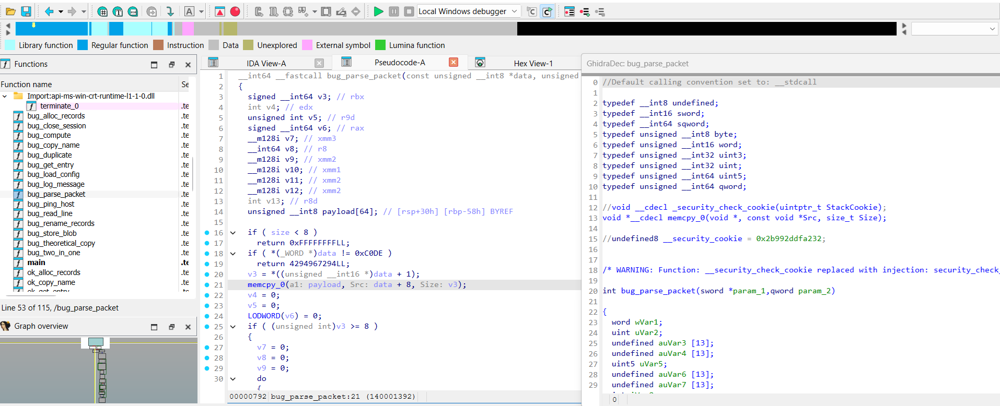
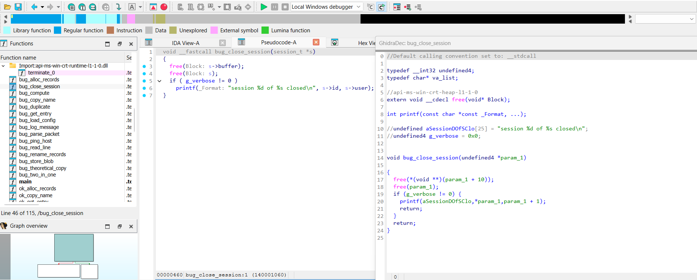

# GhidraDec

Port of [GregoryMorse/GhidraDec](https://github.com/GregoryMorse/GhidraDec) (v1.0, commit `35afec3`) to the IDA C++ SDK 9.4, so Ghidra's decompiler works in IDA Free/Pro 9.4+.

GhidraDec decompiles IDA functions with Ghidra's decompiler. It does not need Java or a running Ghidra: it starts Ghidra's native `decompile.exe` and speaks its protocol. Bytes, names, types, comments and prototypes come straight from the IDA database, and the result is shown in an IDA code viewer. IDA Free's cloud decompiler gives plugins no decompiler API; GhidraDec gives IDA Free a local decompiler that plugins can call (see [C API](#c-api)).



> **Note:** So far the plugin has only been tested on Windows, with IDA Free 9.4, Ghidra 12.1.4 and x64 PE binaries (the ELF loader of the [C API](#c-api) has not been tested). It is a native plugin built with the current SDK, so it should work in IDA Pro too.

The original is already a C++ plugin. This port keeps its decompiler bridge, drops what a current IDA does not need (old SDKs, 32-bit builds, RetDec and jsoncpp), fixes the protocol errors seen with Ghidra 12 and sends the decompiler more of what the database knows: see [Differences from the original](#differences-from-the-original).

## Requirements

- IDA Free/Pro 9.4+ (x64, Windows). Hex-Rays is not needed.
- A Ghidra installation of the **same version** the plugin was built with, in any folder (see [Finding Ghidra](#finding-ghidra)). At run time the plugin uses:
  - `Ghidra\Features\Decompiler\os\win_x86_64\decompile.exe`
  - `Ghidra\Processors\*\data\languages\*.ldefs / .sla / .pspec / .cspec`
- No JDK: Ghidra's Java side is never started.

## Build

Requirements (Windows):

- Visual Studio 2022 with the *Desktop development with C++* workload
- CMake ≥ 3.25 and Ninja (both ship with Visual Studio)
- The IDA SDK matching your IDA version (e.g. [HexRaysSA/ida-sdk](https://github.com/HexRaysSA/ida-sdk)), with the `IDASDK` environment variable pointing to it
- A Ghidra installation, with `GHIDRA_DIR` pointing to it: its decompiler sources (`Ghidra\Features\Decompiler\src\decompile\cpp` and `zlib`) are compiled into the plugin. Nothing is downloaded.

```bat
set IDASDK=C:\path\to\ida-sdk
set GHIDRA_DIR=C:\path\to\ghidra_12.1.4_PUBLIC
build.bat          :: incremental build
build.bat clean    :: build from scratch
```

`build.bat` loads the VS 2022 Developer Command Prompt (x64) and runs CMake + Ninja. The plugin ends up in `bin\ghidradec.dll`, linked with the static CRT (`/MT`), so it does not need the VC++ redistributable.

`GHIDRA_DIR` is also compiled in, with its version (`Ghidra\application.properties`): the folder is one of the places where the plugin looks for Ghidra, and the version is the one it expects.

## Install

Copy `ghidradec.dll` to the `plugins` folder of your IDA installation (e.g. `C:\Program Files\IDA Free 9.4\plugins\`, needs admin) or to `%APPDATA%\Hex-Rays\IDA Pro\plugins\`.

## Usage

| Action | Where |
|---|---|
| Decompile the function under the cursor | `Ctrl-G`, `GhidraDec > Decompile function`, or right-click in the disassembly → `GhidraDec/Decompile function` |
| Decompile every function into a `.c` file | `Ctrl-Shift-G` or `GhidraDec > Decompile all to file...` |
| Settings (Ghidra folder, timeouts, display/analysis options, per-database specs, p-code snippet compiler) | `GhidraDec > Settings...` |
| Version and the Ghidra folder in use | `GhidraDec > About GhidraDec` |

The decompilation runs in a background thread, so IDA stays responsive. Starting a new decompilation while one is still running asks whether to stop the old one.

Inside the viewer, titled `GhidraDec: <function>` (same keys as the original):

| Key | Action |
|---|---|
| double-click | Decompile the called function / jump to a global |
| `Esc` / `Ctrl-F` | Previous / next function in the navigation history |
| `N` | Rename function or global (also renames it in the database) |
| `Y` | Change the type declaration of the current function and decompile again |
| `;` / `Insert` | Edit the function comment |
| `X` / `C` | Xrefs / calls window of the function under the cursor |
| `A` | Jump to the disassembly |

The viewer is saved with the IDA desktop: when IDA closes with it open, reopening the database shows it again with the same function and cursor. Its code comes from the database (`$ ghidradec view` netnode), not from a new decompilation; decompile again to refresh it.

The same function in IDA Free's cloud decompiler (`F5`, left) and in GhidraDec (right). GhidraDec gets the import prototypes (`free`, `printf`) and the names of the globals from the IDA database:



### Processor detection

The IDA processor module is matched with the `<external_name tool="IDA-PRO">` entries of Ghidra's `.ldefs` files, plus the aliases the original adds (`metapc` 16-bit, `arm/armb/aarch64`, `riscv`, `dalvik`, `sh3/sh4/...`). The settings dialog can override the processor spec, compiler spec, sleigh file and prototype per database. These overrides are stored in the database (`GhidraConfig` netnode).

## Settings

Global settings are stored in IDA's registry, under the `GhidraDec` subkey (the original used `ghidradec-config.json` + jsoncpp).

| Key | Default |
|---|---|
| `ghidraPath` | empty: Ghidra is searched for (see below). Written by *Settings* and by the *Ghidra folder* question |
| `viewFeatures` | parameter identification (the IDB backup before each decompilation is opt-in) |
| `cacheSize`, `maxPayload`, `timeout` | 10 functions, 50 MB, 30 s |
| `cmtLevel`, `maxChars`, `numChars`, `comStyle`, `intFormat`, brace styles... | Ghidra defaults |
| `alysChecks`, `behaviorChecks`, `splitDatatypeChecks`, `maxJumpTableSize`, `maxInstructions`, `aliasBlock`, `nanIgnore` | Ghidra defaults |

Environment variables (same as the original): `GHIDRADEC_GHIDRA_DIR` / `GHIDRA_INSTALL_DIR` (used when `ghidraPath` is empty), `GHIDRADEC_PSPEC`, `GHIDRADEC_CSPEC`, `GHIDRADEC_SLEIGH`, `GHIDRADEC_CALL_STYLE`, `GHIDRADEC_TRACE=1`, `GHIDRADEC_PROTOCOL_LOG=<file>`.

### Finding Ghidra

A prebuilt `ghidradec.dll` only knows the Ghidra folder of the machine it was built on, so the folder is checked before Ghidra is used:

1. **The configured folder:** `ghidraPath` from the settings (IDA registry, per Windows user); if it is empty, `GHIDRADEC_GHIDRA_DIR` or `GHIDRA_INSTALL_DIR`.
2. **If Ghidra is not there, it is searched for**, in this order:
   - `GHIDRADEC_GHIDRA_DIR` and `GHIDRA_INSTALL_DIR`;
   - the folder compiled in;
   - the `ghidra*` folders in `C:\`, `C:\Tools`, `%ProgramFiles%`, `%PUBLIC%`, `%PUBLIC%\Tools`, `%USERPROFILE%` and its `Tools`, `Downloads`, `Desktop` and `Documents`, and `%LOCALAPPDATA%\Programs`;
   - scoop (`%USERPROFILE%\scoop\apps\ghidra\current`) and chocolatey (`%ProgramData%\chocolatey\lib\ghidra\tools`).

   Among these, the installations of the build's version come first, then the newest. A folder counts when it has `Ghidra\Features\Decompiler\os\win_x86_64\decompile.exe`. The folder found is used for the session and printed in the Output window; it is not saved, so a Ghidra moved later is found again.
3. **If none is found**, the first decompilation (Ctrl-G, *Decompile all*, or a call through the [C API](#c-api)) asks for the folder. The dialog accepts the Ghidra folder, its `Ghidra` subfolder or the folder that holds it (`...\Tools`). It checks that the folder has `decompile.exe`, asks again if not, and saves the folder in `ghidraPath`. Cancel stops the decompilation.
4. **The version:** Ghidra's `decompile.exe` and its `.sla` files must match the Ghidra sources compiled into the plugin. When the folder's `application.version` is not the build's, the Output window says so at load, and the first decompilation of the session shows a warning. Nothing is blocked.

*Settings* checks the folder too, when you press OK (the same rules as the question). An empty folder means "search for it".

The overrides of each database (processor spec, compiler spec, sleigh file) are absolute paths into the Ghidra folder, saved in the IDB when *Settings* is closed with OK. An IDB moved to another Ghidra folder keeps pointing to the old one; clear those three fields to go back to detection.

### Batch mode

IDA Free has no `-A`/`-S` batch mode, so batch mode is driven by environment variables:

```bat
set GHIDRADEC_BATCH_OUTPUT=C:\work\sample.c
set GHIDRADEC_BATCH_DONE=C:\work\sample.done
"C:\Program Files\IDA Free 9.4\ida.exe" sample.i64
```

When the database is open, the plugin waits for the auto-analysis, decompiles everything into `GHIDRADEC_BATCH_OUTPUT`, writes `success=0|1` into `GHIDRADEC_BATCH_DONE` and closes IDA through its `QuitIDA` action (`qexit()` from a timer can hang the GUI). Check the result in `GHIDRADEC_BATCH_DONE`, not in IDA's exit code.

## What the decompiler gets from the database

Ghidra's decompiler only knows what the plugin tells it. Besides bytes, globals and comments, the port sends:

- **Import prototypes.** `getexternalref` answers with the IDA prototype of the import (parameters with their storage, return type, calling convention, `...`, noreturn), as a locked prototype backed by the import's local scope, the way Ghidra's own Java side does. Imports typed as function pointers (`__imp_X`) are followed to their function type. A prototype with storage Ghidra cannot use (custom/scattered locations, structures passed in registers) falls back to the unlocked shell.
- **Named data types.** `getdatatype` answers in the packed format, so `PROPVARIANT *`, `LPCWSTR`... resolve. Structure fields Ghidra rejects (unnamed, void, overlapping) are dropped; unknown names become `void`. Built-in names (`wchar_t`) are parsed by IDA.
- **Typed stack variables.** Frame members IDA knows more about than their size (structures, arrays, pointers, floats) are sent as type-locked locals in the function's `<localdb>`. Untyped members are left to Ghidra, so they do not pin a stack slot to a wrong size.
- **Demangled names.** Functions are named with IDA's demangled short name without arguments (`CZoneIdentifier::GetNamedValue`); `A::B::f` becomes namespaces, so Ghidra prints the qualified name. The viewer finds a function by its IDA name, its shown name and its last part (`GetNamedValue`).
- **Call fixups.** Functions named like a `<callfixup>` target of the compiler spec get the fixup in their prototype. The MSVC control-flow-guard thunks (`_guard_dispatch_icall$thunk$...`, `_guard_dispatch_icall_nop`, `_guard_xfg_dispatch_icall*`, also reached through `__guard_dispatch_icall_fptr`) get `guard_dispatch_icall`, so the call through them becomes a plain indirect call through `RAX`.

## C API

Other plugins can use GhidraDec without its viewer. [Diaphora-ng for IDA Free/Pro](https://github.com/Claude-Rays/diaphora-ng-idafree) uses it for its *GhidraDec diff pseudo-code*: in IDA Free, that is how a diff gets pseudo-code at all. The functions are exported by `ghidradec.dll` and found with `GetProcAddress`, so there is no link-time dependency. Requests and responses are UTF-8 JSON. The calls run on the main thread and are synchronous: the database queries of `decompile.exe` are answered in place.

| Function | What it does |
|---|---|
| `int ghidradec_api_version()` | `3` |
| `char *ghidradec_diff_functions(const char *req)` | `{"a": {"ea"}, "b": {...}, "a_is_new", "canonical_names", "rename_locals"}`. The last two are optional and default to `true`: `canonical_names` names the locals `v1`, `v2`... on both sides, and `rename_locals` renames the locals of NEW after those of OLD. With both off, the diff shows what Ghidra's decompiler gives. The response echoes both. Decompiles `a.ea` of the open database and the other version from its binary `b.file` (see below), both now, and diffs them. The response holds both sides (`lines`, `source`), the aligned `rows` with the changed spans of each line, the `changes`, and the calls and constants added or removed; or `{"ok": false, "error"}` |
| `void ghidradec_session_end()` | Stops the decompiler processes of the API and forgets the loaded binary of the other version |
| `void ghidradec_free(char *p)` | Releases a response |

- **The other version from its binary** (`src/filedec.*`): `b` = `{"file", "address", "image_base", "name", "prototype", "functions": [{"address", "name", "prototype"}]}`. GhidraDec maps the PE (sections, imports, delay imports, exports) or ELF (`PT_LOAD` segments, symbol tables, `JUMP_SLOT`/`GLOB_DAT` imports) at `image_base` (the other database may be rebased; if the address is not code there, the file's own addresses are tried) and answers the queries of a second `decompile.exe` from it. Processor, compiler spec and options are those of the open database (the file must have the same bitness, endianness and processor family). The names and prototypes of `functions` (IDA C declarations, parsed in the open database's types) name the function and its callees; imports take the prototype of the import of the same name in the open database; C strings in read-only sections are typed as `char` arrays. Function ranges come from the PE x64 `.pdata` (chained unwind entries go to their parent), else from the function up to the next known start.
- **Processes:** the open side gets a new `decompile.exe` for each diff (the database may have changed since the last one). The binary of the other side and its process stay loaded between calls, so only the first diff pays the loading, until `ghidradec_session_end` or the plugin's end. Running the viewer stops the API's process first; the viewer starts its own.
- **No parameter identification** in the API: it would write the prototypes it finds into the database, and both versions of a diff must be decompiled the same way. So the output can differ a little from the viewer's.
- The call fails, with a message, while a decompilation of the viewer is running, before the autoanalysis has finished, or when there is no Ghidra. Its only dialogs are its wait boxes and, when Ghidra is not found or is another version, the question and the warning of [Finding Ghidra](#finding-ghidra), shown before the wait box.
- **The diff** (`src/pairdiff.*`, no IDA headers) first renames the locals of the new version after those of the old one: the locals declared at the top of each body are matched by where they are used in the lines that line up when the locals are masked (each pair gets a vote for each place, the most voted pairs win), the new version takes the names of its matches (`v4` -> `v3`, `pv` -> `pv_00`) and its declarations are sorted in the old order. The locals without a match keep their name, or get a new `vN` if the old version uses it. A real change of variable is then a changed line. The lines are compared through a normalized key, so the diff ignores addresses (`sub_`/`FUN_`/`DAT_`/`LAB_` names with a hex suffix, numbers inside the image, also in comments), the source line number of the WIL diagnostics (the number before a `"file.cxx"` argument), and the indentation and spacing. It aligns with a patience diff (an LCS in the gaps without anchors), pairs the similar lines of a changed block, and marks the changed tokens.
- **Canonical local names** (`src/localnames.*`, no IDA headers): both sides of a diff rename the locals that Ghidra names by position or stack offset (`uVar3`, `pcVar12`, `auStack_48`, `local_28`, `in_stack_...`, `extraout_var`, and IDA's `var_28`) to `v1`, `v2`... in the order of their first use in the body, as IDA does, and sort their declarations by the new names. The same code gives the same names, so the lines line up. The names given by the user and the register ones (`unaff_RBX`, `in_FS_OFFSET`) are kept, and a name already in use is never produced. The renaming works on the variable tokens of the decompiler's XML, not on the text. The viewer does it too with *Canonical local names (v1, v2...)* in the display settings (off by default).

## Mapping original → port

| Original (`src/`) | Port |
|---|---|
| `idaplugin.cpp/.h` (plugmod, `run(arg)`, `plugins.cfg` arguments 0..5) | `src/idaplugin.*`: own `GhidraDec` menu, disassembly popup, separate `HT_VIEW` listener, batch timer |
| `decompiler.cpp/.h` (`IdaCallback`: answers decompiler queries from the IDB) | `src/decompiler.*`, same code with only the SDK 9.4 branches |
| `sleighinterface.cpp/.h` (`DecompInterface`: protocol, sleigh, p-code injection) | `src/sleighinterface.*`, the original plus the packed-protocol fixes; built with Ghidra's sources into the `ghidra_sleigh` static library |
| `code_viewer.cpp/.h` | `src/code_viewer.*` |
| `config_generator.cpp/.h` (RetDec JSON config database) | `NameIndex` in `src/defs.*` (function/global names for the viewer) |
| `plugin_config.cpp/.h` (jsoncpp file) | `src/plugin_config.*` (IDA registry), `src/ghidra_locate.*` (finding Ghidra) |
| `defs.cpp/.h` | `src/defs.*` (only the IDA 9.4 / Windows parts) |
| — | `src/api.*`, `src/filedec.*`, `src/pairdiff.*`, `src/localnames.*`, `src/json.*`: the [C API](#c-api) |
| `deps/` (RetDec + jsoncpp), `tools/*.py`, `ghidradec.targets.json`, `ide/vs`, `GhidraDec-x64dbg` | not needed |

## Differences from the original

- **IDA 9.4+ / x64 / Windows only.** The `IDA_SDK_VERSION < 9xx`, 32-bit and Linux/macOS branches were removed. One plugin, `ghidradec.dll`, instead of `ghidradec.dll` + `ghidradec64.dll`.
- **No RetDec.** The original built a complete RetDec config database (and wrote it as JSON) before every decompilation, only to know whether a word in the viewer is a function or a global. It is replaced by a small name index rebuilt from the database.
- **No jsoncpp.** Settings go to the IDA registry.
- **Ghidra is found, not fixed.** A prebuilt plugin searches for Ghidra and asks for its folder when needed, and warns when its version is not the build's (see [Finding Ghidra](#finding-ghidra)).
- **Menu instead of `plugins.cfg`.** Decompile / Decompile all / Settings / About have their own menu and hotkeys. The regression modes (arguments 3, 4, 5 and the `GHIDRADEC_TEST_*` variables) were dropped; [batch mode](#batch-mode) replaces them.
- **IDB backup is opt-in.** The original saved `<idb>.dec-backup.i64` before every decompilation. It can be turned on in the settings.
- **No control-flow graph view.** The original opened a *GhidraDec Graph* window with the decompiled blocks next to the code, on by default. It was removed entirely (code, setting and default): the decompiled code is shown only as text. Bit 0 of `viewFeatures`, which was the graph, is ignored.
- **The viewer is restored with the desktop** (the same as in [Claude-Rays Decompiler for IDA Free/Pro](https://github.com/Claude-Rays/claude-rays-decompiler-idafree)). The original lost it when IDA closed. See [Usage](#usage).
- **More from the database:** import prototypes, named data types, typed stack variables, demangled names and call fixups. See [What the decompiler gets from the database](#what-the-decompiler-gets-from-the-database).
- **C API** for other plugins (see [C API](#c-api)).
- **Fixed bugs:**
  - `HT_UI` and `HT_VIEW` events went to the same callback, so a UI notification with the same number as `view_close` could be taken for it. They now have separate listeners.
  - `init()` kept a `static bool inited`, so with `PLUGIN_MULTI` the second database opened in the same IDA session got no plugin state. Each database now gets its own instance.
  - The answer to `getexternalref` (calls through imports) was still sent as XML, but Ghidra 12's `decompile.exe` decodes it in the packed binary format, so those functions failed with `Marshaling error: Attribute id is not present`. It is now packed, like `getmappedsymbols`. The same was true for `getdatatype`, which is now packed too.
  - Structure field offsets were written unsigned; Ghidra reads them signed (`Marshaling error: Expecting signed integer attribute`).
  - A function symbol in a namespace without a `<localdb>` makes Ghidra attach its local scope to the global scope, and `decompile.exe` crashed when flushing its cache (`Read pipe is bad`). Such functions always get a `<localdb>` now, as Ghidra's Java side sends.
  - IDA crashed (null pointer in `DecompInterface::regNameToIndex`) at the first decompilation of some databases. The type database is read before the sleigh translator exists, and some function types (COM methods with a `VARIANT` passed by value, for which IDA gives no function details, or with spoiled registers) asked it for register numbers. Those lookups now give "unknown" until the translator is set up.
  - Function types sent as data types (`getdatatype`, e.g. the methods of `IUnknownVtbl`) had a non-void return without storage, which Ghidra rejects (`<returnsym> tag must include a valid storage address`). Their return is now an unlocked `void`: Ghidra recovers it from its use.
  - Anonymous function types were all sent with Ghidra's core name `code` but different prototypes (`Redefinition of code data-type: code`), and with IDA's size instead of 1 (`Primitive code data-type that is not size 1`). They are named after their prototype (`code_stdcall_pop0`, `code_noreturn_...`) and are always 1 byte.
  - Batch mode started before the analysis queued by late FLIRT signatures had finished, and the run was refused (`initial autoanalysis has not been finished`). It waits for `auto_is_ok()` now.
  - Batch mode crashed when IDA quit: `QuitIDA` unloads the plugin before the timer that asked for it returns. The DLL is pinned first.

## License

Like the original, this port is released under the MIT license; see [LICENSE](LICENSE). Parts derive from the RetDec IDA plugin, (c) 2017 Avast Software (MIT). The Ghidra decompiler sources compiled into the plugin are under the Apache License 2.0.
